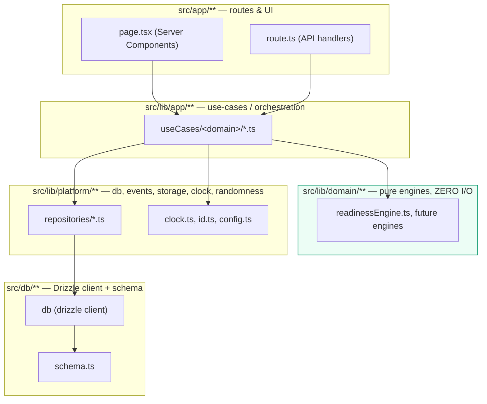

# LEADOS Architecture

This document is the enforced law, not an aspiration. The rules below are checked by
`eslint.config.mjs` (`import/no-restricted-paths`) and fail `npm run lint` — and therefore
`npm run verify` — on violation. See `docs/AUDIT-2026.md` §5 for proof the rule fires.

## Layer diagram

## Dependency rules (enforced)

1. **`src/app/**` (routes/UI)** may import from `src/lib/app/**`. It should not import
   `src/lib/platform/**` or `@/db` directly except for the one documented infrastructure exception
   below. It must not import `src/lib/domain/**` directly — business logic is reached through a
   use case, even when the use case is a thin pass-through, so the orchestration layer has one
   place to add validation, auth, or event emission later without touching UI.
2. **`src/lib/app/**` (use-cases/orchestration)** may import `src/lib/domain/**` and
   `src/lib/platform/**` (repositories and seams). This is the only layer allowed to combine "pure
   calculation" with "I/O" in the same function body.
3. **`src/lib/domain/**` (pure engines)** must have **zero I/O**. No imports from
   `src/lib/platform/**`, `src/lib/app/**`, `src/app/**`, or `@/db`. No calls to `Date.now()`,
   `Math.random()`, `crypto.randomUUID()`, `fetch`, or any filesystem/network/database API. Every
   input arrives as a function argument; every output is a plain, deterministic value. This is what
   makes engines unit-testable without a database and safe for later parts to swap or A/B.
4. **`src/lib/platform/**` (db, events, storage, clock, randomness)** must not import from
   `src/lib/app/**` or `src/app/**` — the lowest layer cannot depend on anything above it. Only
   `src/lib/platform/repositories/**` may import the Drizzle client (`@/db`) and
   `@/db/schema`; every other repository or non-repository platform module reaches Postgres through
   a repository, not through `@/db` directly.
5. **Documented exception:** `src/app/api/health/route.ts` imports `@/db` directly to run
   `select 1` as a liveness probe. A health check is infrastructure, not a feature, and forcing it
   through a repository/use-case would hide what it is actually testing. This is the only
   permitted exception and it is called out here so it cannot silently multiply — any other route
   importing `@/db` directly is a lint violation and a code review rejection.

## Where each existing `src/lib` module lives today vs. its target

Part 00 ships a from-scratch, from-the-start-correct layering — there is no migration debt yet
(see `docs/AUDIT-2026.md` §0 and §3). The table below is therefore the full inventory, not a
before/after:

| Module | Current home | Correct per law? |
|---|---|---|
| `readinessEngine.ts` | `src/lib/domain/leadership/` | Yes — pure, zero I/O, verified. |
| `createOrganization.ts`, `listOrganizations.ts` | `src/lib/app/useCases/organizations/` | Yes. |
| `registerLeader.ts`, `listLeaders.ts` | `src/lib/app/useCases/leaders/` | Yes. |
| `getDashboardSummary.ts` | `src/lib/app/useCases/dashboard/` | Yes. |
| `organizationRepository.ts`, `leaderRepository.ts`, `eventRepository.ts` | `src/lib/platform/repositories/` | Yes — only modules importing `@/db`. |
| `clock.ts`, `id.ts` | `src/lib/platform/` | Yes — seams, no consumers from `app`/`src/app` import them upward. |
| `config.ts` | `src/lib/platform/` | Yes — read only by `src/instrumentation.ts` and the health route. |

## Migration order for later parts (Parts 01–20)

This is the order later parts should add capability in, so each addition lands on a layer that
already exists and is already enforced:

1. **Part 01–02 (data model growth):** add tables to `src/db/schema.ts`, one repository per table in
   `src/lib/platform/repositories/`. Never let a use-case or a route touch `@/db` directly (the
   health-check exception above is the only one that exists; do not add a second).
2. **Part 03–05 (domain engines):** every new scoring/rules/simulation engine goes in
   `src/lib/domain/<topic>/`, written against plain arguments, unit-tested without a database
   connection. If an engine needs "now" or an id, it receives `Clock`/`IdGenerator` as a parameter
   (see `src/lib/platform/clock.ts`, `id.ts`) rather than reaching for the global directly — that is
   why those seams exist even with a single consumer today.
3. **Part 06–08 (orchestration/agent loop):** the autonomous agent loop belongs in
   `src/lib/app/useCases/agent/` (not a new top-level directory) and composes existing domain
   engines + repositories exactly like `registerLeader.ts` does today. If/when it needs to call
   itself on a schedule, the scheduler is a platform concern (`src/lib/platform/scheduler.ts`), not
   something the use case module manages itself.
4. **Part 09+ (read models / projections):** if event-sourced read models are introduced beyond the
   simple `event_log` table, they are new repositories reading `event_log`, not a parallel ORM or a
   second database client. See `docs/adr/0005-event-versioning-posture.md`.
5. **Any part introducing a second UI surface** (e.g. a CLI, a public API with its own auth) should
   extract shared non-route logic into `src/lib/app` use cases first — the UI surface itself is
   always the thinnest possible layer per rule 1.

Modules judged too risky to move in Part 00: **none** — there was nothing to move. This section will
carry real migration debt starting in whichever part first adds a module that violates the law
under deadline pressure; when that happens, record the violation and its target fix here instead of
letting it become invisible technical debt.
