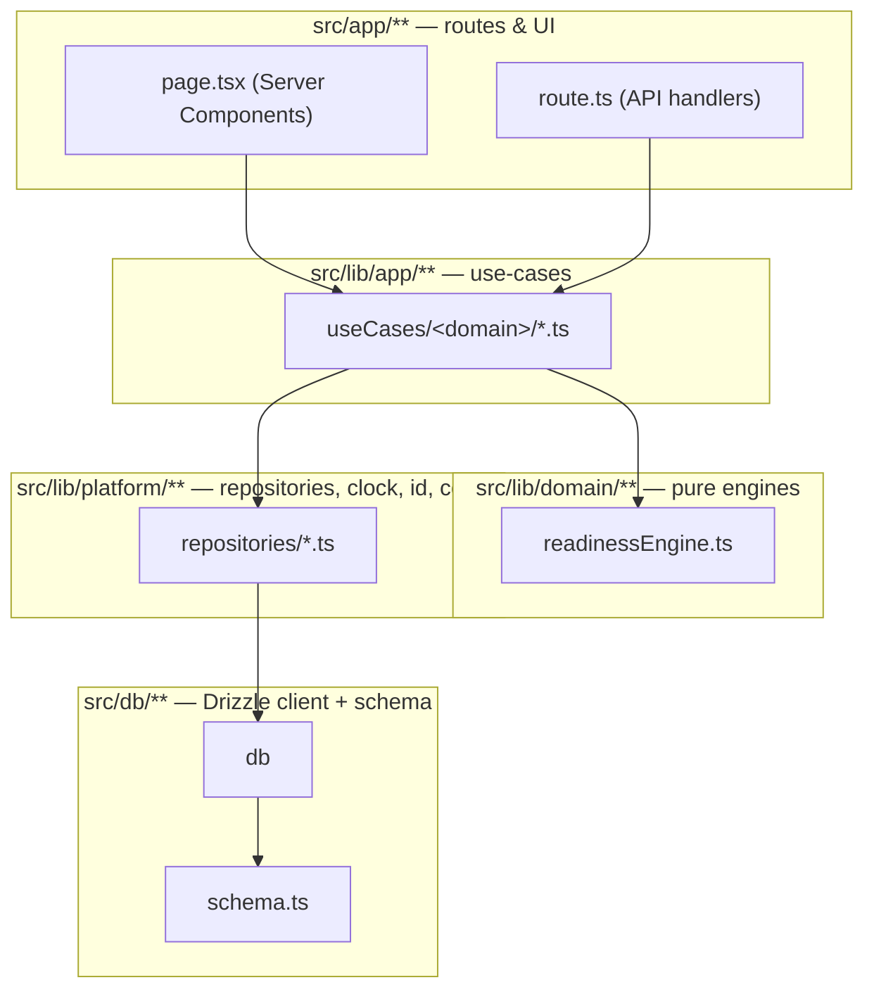
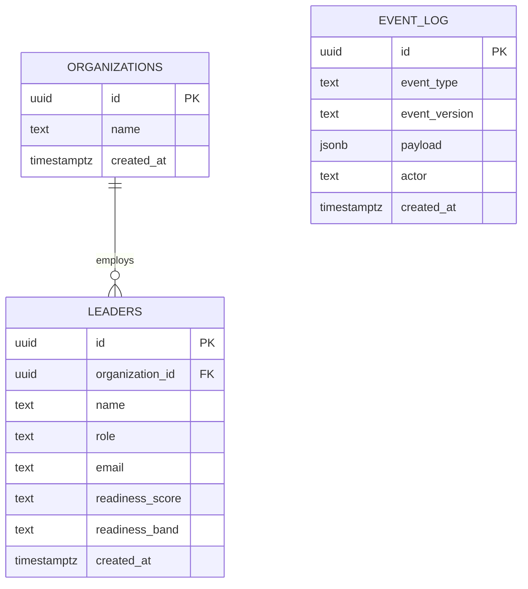

# LEADOS

LEADOS is an autonomous leadership-intelligence operating system. It tracks organizations and the
leaders inside them, computes a leadership-readiness signal from a pure, testable scoring engine,
and records every state change to an append-only event log so later parts of this program can build
audit trails, analytics, and an autonomous agent loop on top of a reliable history instead of
reverse-engineering intent from table state.

This README is Part 00's deliverable: it documents exactly what exists today. Every claim below
cites the file that backs it. Nothing here describes a feature the code does not implement — see
`docs/AUDIT-2026.md` for the measured baseline this document is generated from, and `FEATURES.md`
for the one-row-per-capability contract later parts update.

## Architecture



Full dependency rules, the lint-enforced boundaries, and the migration order for later parts are in
[`ARCHITECTURE.md`](./ARCHITECTURE.md). The decisions behind this shape are recorded as ADRs in
[`docs/adr/`](./docs/adr/).

## Routes

Generated from, and must always equal, `routes` exported by
[`src/app/routes.ts`](./src/app/routes.ts) — see `docs/AUDIT-2026.md` §2 for the cross-check against
the filesystem (0 mismatches as of this delivery).

### Pages

| Path | File | Status | What it does |
|---|---|---|---|
| `/` | `src/app/page.tsx` | live | Dashboard: organization/leader counts and recent events, via `getDashboardSummary()`. |
| `/organizations` | `src/app/organizations/page.tsx` | live | List organizations; create one via a server action. |
| `/leaders` | `src/app/leaders/page.tsx` | live | List leaders with computed readiness score and band. |
| `/leaders/new` | `src/app/leaders/new/page.tsx` | live | Register a leader; feeds the pure readiness engine. |

### API

| Path | Methods | File | Status | What it does |
|---|---|---|---|---|
| `/api/health` | GET | `src/app/api/health/route.ts` | live | Validates config, runs `select 1`. |
| `/api/organizations` | GET, POST | `src/app/api/organizations/route.ts` | live | List/create organizations. |
| `/api/leaders` | GET, POST | `src/app/api/leaders/route.ts` | live | List/register leaders. |

## Data model

Defined in [`src/db/schema.ts`](./src/db/schema.ts), 3 tables (verified:
`psql ... -c "select table_name from information_schema.tables where table_schema='public'"` returns
exactly `event_log`, `leaders`, `organizations`):



`event_log` has no foreign key to `organizations`/`leaders` by design — it is a generic append-only
record keyed by `eventType`, with referenced ids living inside `payload`. See
`docs/adr/0005-event-versioning-posture.md`.

## Quickstart (5 commands)

Requires Postgres reachable at the URL in `.env` (`DATABASE_URL`, see
[`docs/CONFIG.md`](./docs/CONFIG.md)):

```bash
npm install
npm run db:push
npm run db:seed
npm run build
npm run start
```

For local iteration, swap the last command for `npm run dev`. `npm run verify` runs
typecheck + lint + build in one command and is the gate every part of this program must pass.

## Capability matrix

One row per user-facing capability; the canonical, currently-maintained version of this table is
[`FEATURES.md`](./FEATURES.md). Three representative claims and the files that back them, so this
README cannot drift from code the way the standing order for this program warns about:

1. **"Leadership readiness is computed by a pure function with zero I/O."** →
   `src/lib/domain/leadership/readinessEngine.ts` (`computeReadiness`), enforced by the
   `import/no-restricted-paths` rule in `eslint.config.mjs` — see `docs/AUDIT-2026.md` §5 for proof
   the rule fires on a forbidden import.
2. **"Every Postgres access goes through a repository."** →
   `src/lib/platform/repositories/{organizationRepository,leaderRepository,eventRepository}.ts` are
   the only modules (besides the documented health-check exception) importing `@/db` — see
   `ARCHITECTURE.md` rule 4/5.
3. **"Every state change is recorded to an append-only event log."** →
   `src/lib/app/useCases/organizations/createOrganization.ts` and
   `src/lib/app/useCases/leaders/registerLeader.ts` both call
   `eventRepository.append()`; verify directly: `select event_type, created_at from event_log order
   by created_at desc limit 10;`.

## Project documents

- [`ARCHITECTURE.md`](./ARCHITECTURE.md) — layering law, diagram, migration order.
- [`docs/AUDIT-2026.md`](./docs/AUDIT-2026.md) — measured baseline (LOC, routes, engines, lint/build
  numbers), with the exact commands used.
- [`docs/CONFIG.md`](./docs/CONFIG.md) — every environment variable and every `db:*` script.
- [`docs/adr/`](./docs/adr/) — architecture decision records.
- [`FEATURES.md`](./FEATURES.md) — the live feature contract later parts update.
- [`AI-SESSION-LOG.md`](./AI-SESSION-LOG.md) — session-by-session ledger for this program.
- [`deprecated/README.md`](./deprecated/README.md) — explains why this directory is empty.

## Status

This is Part 00 of a 21-part program. The application is a working, deployed-shape vertical slice
(organizations → leaders → readiness scoring → event log) built to prove the architecture end to
end, not the full LEADOS product. See `FEATURES.md` for what is explicitly not built yet.
