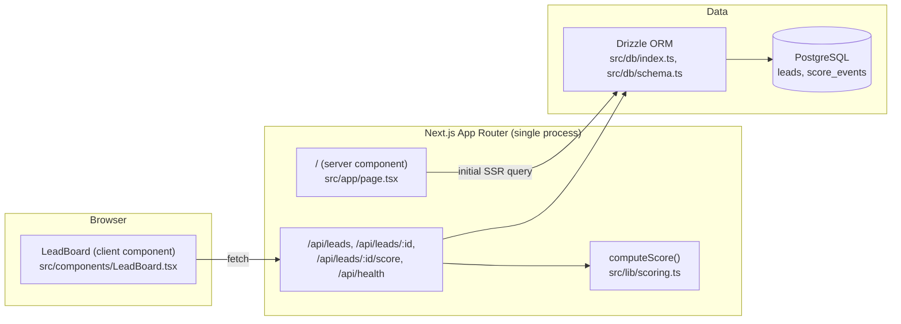

# LEADOS

LEADOS is a lead-intake and scoring board: you add a lead, it is scored by a transparent
rule-based formula you can read in one file, and you record a qualify/disqualify decision — all
backed by Next.js, Drizzle ORM, and PostgreSQL. It is deliberately small today: a single-tenant,
unauthenticated internal tool, not a multi-tenant SaaS platform (yet — see the Roadmap below).
Every claim in this README is backed by a file in the repo; see the Claim-to-file table.

> **Status: v0.1.0, pre-auth, single-tenant, no automated test suite.** Read `FEATURES.md` before
> you deploy this anywhere reachable by people you don't trust — the Security & privacy section
> below is not boilerplate.

## Capability matrix

The full, status-honest capability matrix (🟢 Live / 🟡 Partial / ⚪ Planned) lives in
[`FEATURES.md`](./FEATURES.md). Headline summary:

| Area | Status |
|---|---|
| Lead CRUD + rule-based scoring + decision workflow | 🟢 Live |
| Score audit trail | 🟢 Live |
| Dashboard (add / score / decide) | 🟢 Live |
| Authentication & authorization | ⚪ Planned |
| Multi-tenancy | ⚪ Planned |
| Fairness auditing | ⚪ Planned (no ML exists to audit) |
| Realtime updates | ⚪ Planned |
| Scenario/simulation engine | ⚪ Planned |
| Automated tests | ⚪ Planned |

## Architecture



There is one deployable artifact (the Next.js app) and one stateful dependency (PostgreSQL). No
message queue, no cache layer, no background workers exist. See
[`docs/explanation.md`](./docs/explanation.md) for the full architecture discussion, including
what is deliberately *not* here yet.

## Quickstart (5 commands)

```bash
cp .env.example .env        # point DATABASE_URL at your PostgreSQL instance
npm install
npm run db:push             # creates/updates the leads and score_events tables
npm run seed                # inserts 4 sample leads so the board isn't empty
npm run dev                 # open http://localhost:3000
```

For the guided version of this (what each step should show you, and what to do when something
looks wrong), see [`docs/tutorials.md`](./docs/tutorials.md).

## What the screens actually look like

No screenshots are included in this repository snapshot (there is no image-capture step in CI,
and a stale/unverifiable screenshot is worse than none — honesty rule for this release). Instead,
here is a faithful text description of the one real screen:

- **`/` (dashboard):** a white card on a light-slate background. Header reads "Lead intake & rule-based
  scoring". Below it, a 2-column form (Name, Email, Company, Source dropdown, Notes) with a dark
  "Add lead" button spanning both columns. Below the form, a table with columns Lead / Source /
  Score / Status / Decision. The Score column is a rounded pill button — clicking it forces a
  rescore; hovering it shows the raw breakdown JSON as a tooltip. The Decision column is a
  `<select>` that PATCHes the lead's status immediately on change.

## Security & privacy posture (summary)

- **No authentication exists.** Anyone who can reach the process can read, create, modify, and
  delete every lead. This is acceptable only behind a network you already trust (e.g. a VPN or
  localhost). Do not expose this publicly without adding auth first.
- **No protected-class or demographic data is collected.** The schema (`src/db/schema.ts`) has no
  column for race, gender, age, disability status, or similar. This is a verifiable negative
  claim, not a policy document — check the file.
- **No outbound network calls are made with lead data.** `computeScore()` is pure and local; there
  is no enrichment API, no analytics beacon, no third-party scoring service.
- **Secrets:** the only secret is `DATABASE_URL`, read from `.env` (never committed — see
  `.env.example`). There is no credential rotation automation yet; see
  [`docs/how-to-guides.md`](./docs/how-to-guides.md) → "Rotate credentials" for the manual
  procedure.
- Full threat discussion: [`docs/explanation.md`](./docs/explanation.md) → "Security posture".

## Roadmap

This roadmap is **intent, not capability**. Nothing in this list is implemented unless it also
appears as 🟢 Live in `FEATURES.md`.

| Milestone | Depends on | Target shape |
|---|---|---|
| M1 — Auth | none | Session-based auth for the dashboard and API; every route in `src/app/api/` gains a check. |
| M2 — Multi-tenancy | M1 | `tenant_id` on `leads`/`score_events`, scoped queries, tenant-scoped API keys. |
| M3 — Automated test suite | none (can start immediately) | Unit tests for `computeScore()`, integration tests for the API routes, a smoke test hitting `/api/health`. |
| M4 — Realtime board | M1 | Server-Sent Events or WebSocket push so a second open tab sees new leads/decisions without refresh. |
| M5 — Scenario/simulation engine | M3 | A replay tool that re-runs historical leads through a candidate scoring version and diffs outcomes before you ship the rule change. |
| M6 — Fairness auditing | M5 | Only meaningful once there is a learned model or enough scored history to audit; today there is neither. |

## Documentation set

Start at [`docs/INDEX.md`](./docs/INDEX.md). It links every document below, organized by the four
Diátaxis voices:

- Tutorial: [`docs/tutorials.md`](./docs/tutorials.md)
- How-to guides: [`docs/how-to-guides.md`](./docs/how-to-guides.md)
- Reference: [`docs/reference.md`](./docs/reference.md)
- Explanation: [`docs/explanation.md`](./docs/explanation.md)
- Release engineering: [`docs/RELEASING.md`](./docs/RELEASING.md), [`docs/ROLLBACK.md`](./docs/ROLLBACK.md)
- Deployment: [`docs/DEPLOYMENT.md`](./docs/DEPLOYMENT.md)
- Maintainer runbook: [`docs/MAINTAINER-RUNBOOK.md`](./docs/MAINTAINER-RUNBOOK.md)
- ADRs: [`docs/adr/INDEX.md`](./docs/adr/INDEX.md)
- Consistency sweep (this release): [`docs/CONSISTENCY-SWEEP.md`](./docs/CONSISTENCY-SWEEP.md)
- Archived/superseded material: [`docs/history/README.md`](./docs/history/README.md)

## Claim-to-file table (top 20 claims)

| # | Claim in this README/FEATURES.md | Backing file(s) |
|---|---|---|
| 1 | Leads are scored by a transparent, rule-based formula | `src/lib/scoring.ts` |
| 2 | Every score is explainable as a named breakdown | `src/lib/scoring.ts` (`breakdown` object) |
| 3 | Every score computation is recorded in an audit trail | `src/db/schema.ts` (`scoreEvents`), `src/app/api/leads/route.ts` |
| 4 | Leads can be created via a JSON API | `src/app/api/leads/route.ts` (`POST`) |
| 5 | Leads can be listed and filtered by status | `src/app/api/leads/route.ts` (`GET`) |
| 6 | A lead can be fetched with its score history | `src/app/api/leads/[id]/route.ts` (`GET`) |
| 7 | A lead's status/decision can be updated | `src/app/api/leads/[id]/route.ts` (`PATCH`) |
| 8 | A lead can be deleted | `src/app/api/leads/[id]/route.ts` (`DELETE`) |
| 9 | Scores can be force-recomputed | `src/app/api/leads/[id]/score/route.ts` |
| 10 | The app exposes a health endpoint with DB check and version | `src/app/api/health/route.ts` |
| 11 | The dashboard scores a new lead immediately on add | `src/app/page.tsx`, `src/components/LeadBoard.tsx` |
| 12 | The dashboard records qualify/disqualify decisions | `src/components/LeadBoard.tsx` (status `<select>`) |
| 13 | Schema changes apply without hand-written migrations | `drizzle.config.json`, `package.json` (`db:push`) |
| 14 | A seed script provides onboarding sample data | `scripts/seed.ts` |
| 15 | No protected-class/demographic data is collected | `src/db/schema.ts` (absence of such columns) |
| 16 | No authentication exists yet | `src/app/api/leads/route.ts` (no auth check in source) |
| 17 | No automated test suite exists yet | repository contains no `*.test.*` / `*.spec.*` files |
| 18 | Docs link freshness is enforced automatically | `scripts/check-docs-links.mjs`, `package.json` (`verify`) |
| 19 | The release workflow runs the full gate suite on tag push | `.github/workflows/release.yml` |
| 20 | The container image is a single multi-stage Dockerfile | `Dockerfile` |

Three of these are spot-checked in the verification log below (claims 3, 11, and 17).

## Contributing & governance

See [`CONTRIBUTING.md`](./CONTRIBUTING.md), [`docs/adr/INDEX.md`](./docs/adr/INDEX.md), and
[`CODE_OF_CONDUCT.md`](./CODE_OF_CONDUCT.md).

## Changelog

See [`CHANGELOG.md`](./CHANGELOG.md) (Keep a Changelog format, Semantic Versioning).
