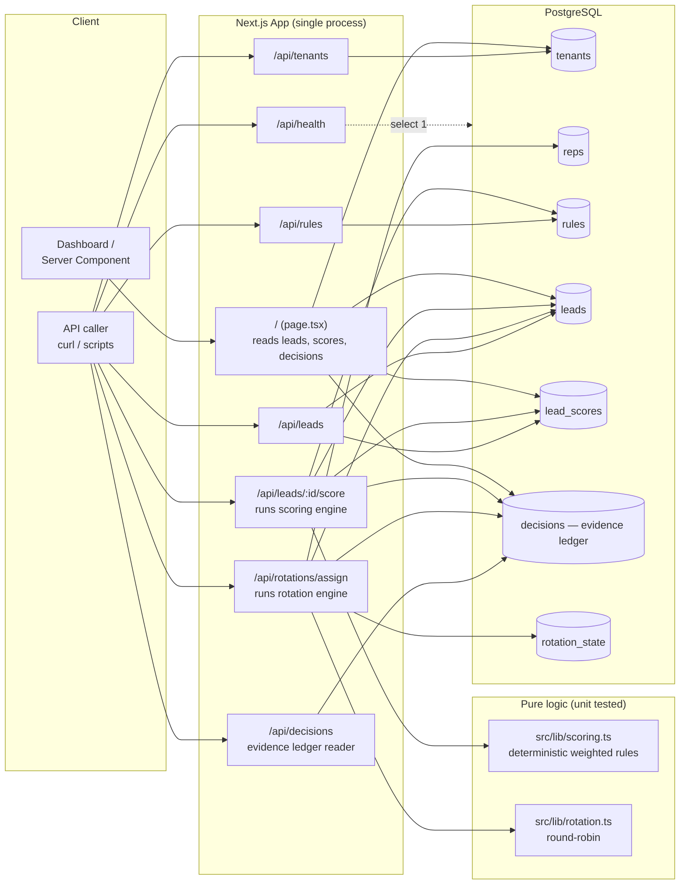

# LEADOS Architecture (2026 baseline, v0.1.0)

## System diagram

## Process model

LEADOS v0.1.0 is a single Next.js application (App Router, Node runtime) talking directly to one
PostgreSQL database through Drizzle ORM (`src/db/index.ts`). There is no separate worker process, queue,
cache layer, or external service dependency. Every API route handler under `src/app/api/**/route.ts`
opens its own query against the shared connection pool and returns JSON.

## The four real subsystems

1. **Scoring (`src/lib/scoring.ts`).** A pure function that evaluates a tenant's active `rules` rows
   against a lead's `signals` JSON blob (merged with first-class lead columns such as `source`) and
   returns a `0–100` score, a `hot`/`warm`/`cold` band, and a per-rule breakdown. No machine learning, no
   causal inference — see `docs/explanations/intelligence-methodology.md` for the honest rationale.
2. **Rotation (`src/lib/rotation.ts`).** A pure round-robin function over a tenant's active reps, keyed
   by the id of whoever was assigned last (`rotation_state` table).
3. **Evidence ledger (`decisions` table, written from `src/app/api/leads/[id]/score/route.ts` and
   `src/app/api/rotations/assign/route.ts`).** Every automated scoring or rotation action writes one
   append-only row recording a human-readable summary and the raw evidence used to make the decision. See
   `docs/EVIDENCE-LEDGER.md`.
4. **Tenancy (`tenant_id` foreign keys across every table, resolved in `src/lib/tenant.ts`).** All data is
   partitioned by `tenant_id`. The active tenant is resolved from a `?tenant=` query parameter or an
   `x-leados-tenant` header — there is intentionally no authentication yet (see `docs/SECURITY.md`).

## Known architectural gaps (roadmap, not implemented)

- No authentication/authorization — any caller that can name a tenant slug can read/write that tenant's
  data (`src/lib/tenant.ts:6-9`).
- No background jobs/queue — scoring and rotation are synchronous, request-triggered actions only.
- No caching layer — every request hits PostgreSQL directly.
- No horizontal scale-out story beyond what a stateless Next.js deployment + a managed Postgres gives you
  for free; there is no sharding, read replica routing, or connection pooler configuration documented.
- No realtime/event-streaming layer (see `docs/REALTIME.md`).

These gaps are tracked, not hidden, and are reflected in `FEATURES.md` and `docs/THREAT-MODEL.md`.
